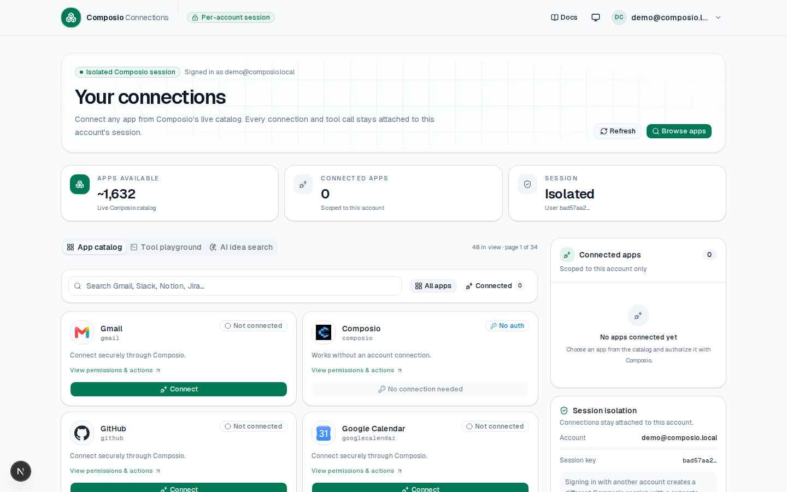
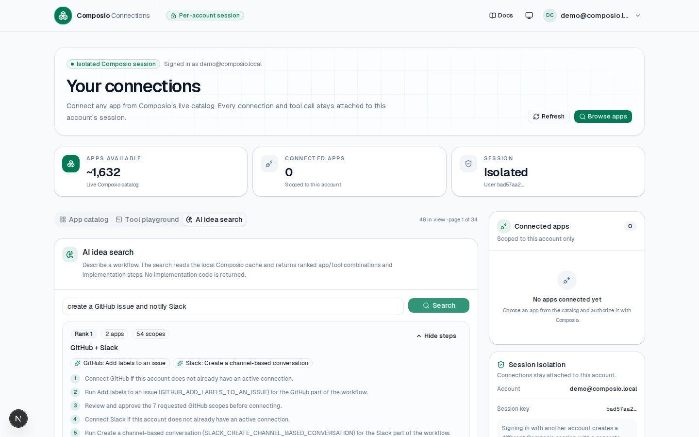

# Composio AI Idea Search

[](LICENSE)

A multi-user Next.js application where each registered email/password account gets its **own isolated Composio session**. It browses Composio's live toolkit catalog, caches app metadata, scopes, and actions locally, and includes an AI idea search that suggests implementation steps and ranked tool combinations without generating code.

There is no hardcoded app list: the catalog, connection state, Connect Links, and tool execution all come from Composio at runtime.

## What it does

- Register and sign in with email + password only.
- Isolates every account with a stable Composio user ID.
- Fetches the full toolkit catalog with pagination and search.
- Caches toolkit metadata, scopes, and action previews in `.data/composio-cache.json` to avoid repeated backend calls.
- Searches the local Composio cache for AI idea workflows and returns ranked combinations with implementation steps only.
- Generates a Composio **Connect Link** for any toolkit a user selects.
- Shows connected apps and lets users disconnect them.
- Executes any tool through the same account-scoped session.
- Ships with a light/dark theme and a shadcn/ui dashboard.

## Screenshots





## Setup

The fastest setup is one command after adding your Composio project key:

```bash
cp .env.example .env.local
# Edit .env.local and set COMPOSIO_API_KEY
npm run setup
npm run dev
```

`npm run setup` installs dependencies, generates `AUTH_SECRET`, installs and starts Ollama, pulls the small local model (`qwen2.5:0.5b`), bulk-feeds the Composio cache, and builds the app. After setup, only `COMPOSIO_API_KEY` needs to be provided by you.

Manual setup is also supported:

```bash
npm install
cp .env.example .env.local
```

Create `.env.local` with:

```bash
COMPOSIO_API_KEY=ak_...
AUTH_SECRET=<random 32+ character secret>
NEXT_PUBLIC_APP_URL=http://localhost:3000
```

- Get the Composio **project** key from Dashboard → Settings → Project Settings → API Keys. Do not use a `uak_...` user key for this backend.
- Generate `AUTH_SECRET` with `openssl rand -hex 32`.
- `NEXT_PUBLIC_APP_URL` is optional locally, but required behind a proxy or tunnel so OAuth callbacks return to the right origin.
- Optional local-model settings are already included in `.env.example`.

Start the app:

```bash
npm run dev
```

Open `http://localhost:3000`. You will be redirected to `/login` until you register an account.

## Accounts and isolation

The local demo auth lives in `lib/auth.ts`:

- Passwords are hashed with `scrypt` and a random salt.
- The session cookie is HttpOnly, SameSite=Lax, and HMAC-signed with `AUTH_SECRET`.
- Each registration gets a random UUID.
- That UUID is passed to `composio.sessions.create(userId)`, so two accounts cannot see each other's Composio connections.

Local data is stored in `.data/`:

| File | Contents |
| --- | --- |
| `.data/users.json` | Hashed demo accounts. |
| `.data/composio-sessions.json` | Composio session ID per app account. |
| `.data/composio-cache.json` | Cached toolkit metadata, scopes, and action previews. |
| `.data/composio-preload-state.json` | Last bulk preload date and counts. |

All are gitignored. This is a demo store, not production auth.

## UI

The auth screens and dashboard use shadcn/ui components: Button, Input, Label, Card, Badge, Alert, Avatar, DropdownMenu, Tabs, Skeleton, Dialog, AlertDialog, Textarea, Separator, Tooltip, and Sonner.

Theme switching uses `next-themes` with light, dark, and system options. The auth screen and dashboard hero use the pointer-reactive `InteractiveGrid` primitive in `components/ui/interactive-grid.tsx`.

> **21st.dev MCP:** `https://21st.dev/api/mcp` requires a paid 21st API key. This project therefore uses the underlying shadcn/ui primitives directly. If you add a 21st key later, its MCP catalog can be used to pull specific component code.

## Verify a real tool call

The Tool playground preloads `HACKERNEWS_GET_USER`, which needs no account connection. Click **Run tool** and you should see a real provider result plus a Composio `logId`.

You can also run the auth + catalog + execution flow against a running dev server:

```bash
npm run smoke
```

The smoke script registers (or signs into) `smoke@composio.local` with a local demo password, verifies signed-out catalog access returns `401`, creates a Composio session, and executes the no-auth Hacker News tool.

To verify an app integration, connect an app in the catalog and use the tool search in the playground. For example, after connecting Gmail:

```json
{
  "toolSlug": "GMAIL_GET_PROFILE",
  "arguments": { "user_id": "me" }
}
```

## How the pieces fit

| File | Purpose |
| --- | --- |
| `lib/auth.ts` | Password hashing, signed cookie sessions, local user store. |
| `lib/identity.ts` | Maps the authenticated account ID to a Composio user ID. |
| `lib/session-store.ts` | Reuses one Composio session per account. |
| `app/api/auth/*` | Register, login, logout, and current-user endpoints. |
| `app/api/toolkits/route.ts` | Paginated live catalog with search and connected filter. |
| `app/api/connect/route.ts` | Connect Link redirect (`GET`) and JSON API (`POST`). |
| `app/api/connections/route.ts` | Lists active connections for the account. |
| `app/api/disconnect/route.ts` | Deletes one account-scoped connection. |
| `app/api/search/route.ts` | Semantic tool search across apps. |
| `app/api/execute/route.ts` | Executes any tool inside the account session. |
| `app/login/page.tsx`, `app/register/page.tsx` | Auth screens. |
| `app/dashboard/page.tsx` | Server-protected dashboard shell. |
| `app/dashboard/apps/[slug]/page.tsx` | Live app detail page with permissions, scopes, and action browser. |
| `app/api/composio-advisor/route.ts` | Ranks cached apps/actions by requirement and requested scopes. |
| `scripts/preload-composio.mjs` | Bulk-feeds all apps, scopes, and actions into the local cache. |
| `components/dashboard/*` | Catalog, connected apps, tool playground, and app detail sections. |
| `components/auth/*` | shadcn/ui auth form and branding panel. |

### Request flow

1. `POST /api/auth/register` or `/api/auth/login` creates an HttpOnly session cookie.
2. The dashboard calls `GET /api/session`, which reuses or creates a Composio session for the account UUID.
3. Toolkit metadata, scopes, and action previews are read from the local Composio cache in `.data/composio-cache.json` when fresh; otherwise they are fetched from Composio once and stored.
4. The dashboard opens `GET /api/connect?toolkit=...` in the current tab. That route calls `session.authorize(toolkit)` and returns a `303` to the Connect Link. `POST /api/connect` remains available for JSON clients.
5. The user authorizes with the provider; Composio stores the connected account.
6. `POST /api/execute` calls `session.execute(toolSlug, args)`.

No provider OAuth flow is implemented here. Composio owns that flow and returns the Connect Link.

The local cache is intentionally short-lived (24 hours by default) so toolkit metadata can refresh without stale production data. Sessions and toolkit cache are stored locally; only genuinely required backend calls are made to Composio.

## Before production

- Replace the local JSON user store with your real database and auth system.
- Replace the local session store with your database and add a per-user lock for concurrent first requests.
- Keep `COMPOSIO_API_KEY` and `AUTH_SECRET` in a server-side secret manager; never expose them with `NEXT_PUBLIC_`.
- Add rate limits, CSRF protection for cookie-auth mutations, and request-size limits.
- Require explicit user confirmation before write or destructive tools.
- Set `NEXT_PUBLIC_APP_URL` to your public origin.
- Review Composio's production guidance and logs for each execution.

## Bulk local data and AI advisor

Feed every app, scope, and action into `.data/composio-cache.json`:

```bash
npm run preload          # runs on Saturday
npm run preload:force    # runs immediately
```

The preload script checks for updates and adds new or changed toolkits. Run it from cron on Saturday, for example:

```bash
0 2 * * 6 cd /path/to/app && npm run preload
```

Ask the local advisor for a least-privilege combination:

```json
POST /api/composio-advisor
{
  "requirement": "create a GitHub issue and notify Slack",
  "limit": 10
}
```

The advisor reads the local cache, ranks apps and actions by requirement match, then by fewer requested scopes. This gives AI or developer tooling a compact candidate list without sending repeated catalog calls to Composio.

Optional provider configuration:

The app supports user-selected providers and models. Configure a shared fallback in `.env.local`:

```bash
SHARED_LLM_PROVIDER=openai
SHARED_LLM_MODEL=gpt-4o-mini
SHARED_LLM_API_KEY=sk_...
SHARED_LLM_BASE_URL=
SHARED_LLM_DAILY_LIMIT=20
```

Supported providers:
- OpenAI
- OpenRouter
- Anthropic (Claude)
- xAI (Grok)
- Ollama
- Custom OpenAI-compatible endpoint

Users can also enter their own API key in the dashboard **AI settings** tab. Personal keys are encrypted on the server and are never returned to the browser. When no personal key is configured, the app uses shared platform access subject to the daily limit.

Backward-compatible local model configuration:

```bash
LOCAL_LLM_URL=http://127.0.0.1:11434
LOCAL_LLM_MODEL=qwen2.5:0.5b
LOCAL_LLM_TIMEOUT_MS=60000
```

When configured, the idea-search endpoint can send retrieved candidates to the configured model and return AI-refined steps. If no model is available, the deterministic search result is still returned.

## Docker

Run the app and local model with Docker Compose:

```bash
cp .env.example .env
# Edit .env and set COMPOSIO_API_KEY
docker compose up --build
```

The Compose file starts Ollama, pulls `qwen2.5:0.5b`, bulk-feeds the local cache, and starts the Next.js app. The app is available at `http://localhost:3000`.

Health check:

```bash
curl http://localhost:3000/api/health
```

## Open source

- License: MIT (`LICENSE`)
- Contributing guide: `CONTRIBUTING.md`
- Code of conduct: `CODE_OF_CONDUCT.md`
- Issue templates: `.github/ISSUE_TEMPLATE/`
- CI workflow template: `docs/ci.yml` (copy to `.github/workflows/ci.yml` to enable GitHub Actions)
- Roadmap: `ROADMAP.md`

## Useful commands

```bash
npm run dev        # start the app
npm run build      # production build
npm run typecheck  # TypeScript check
npm run smoke      # auth + catalog + real no-auth tool call
```
